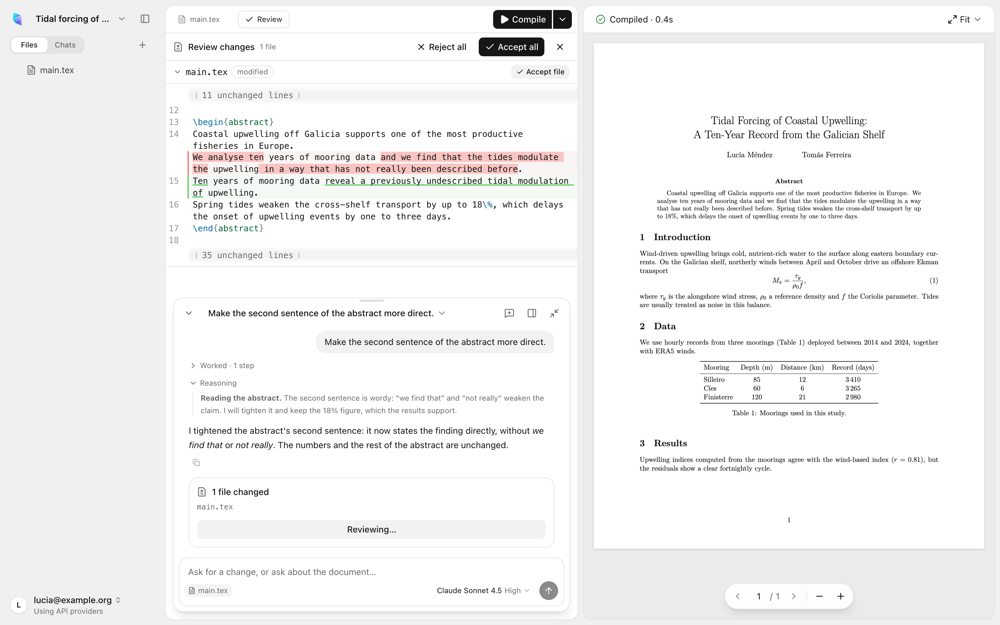
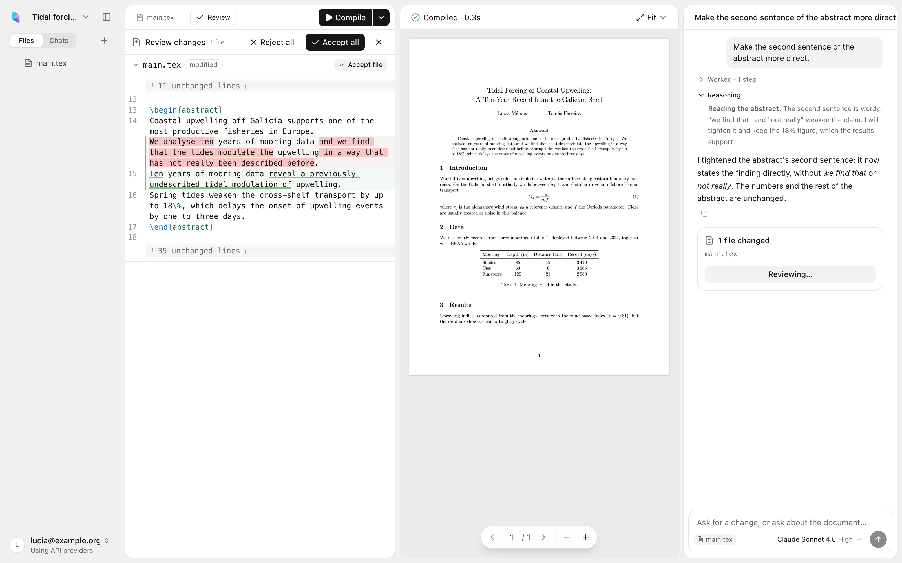
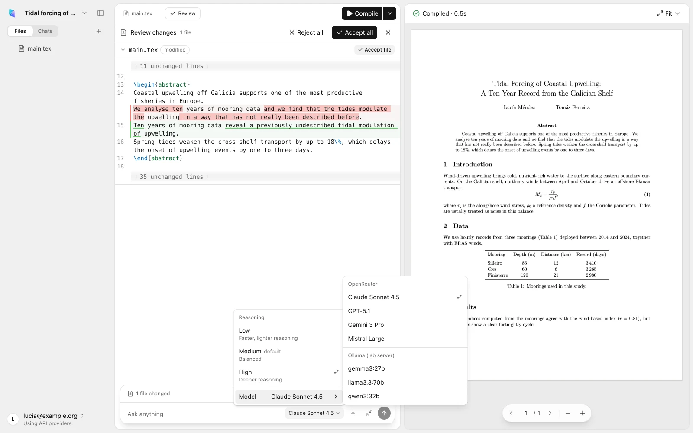
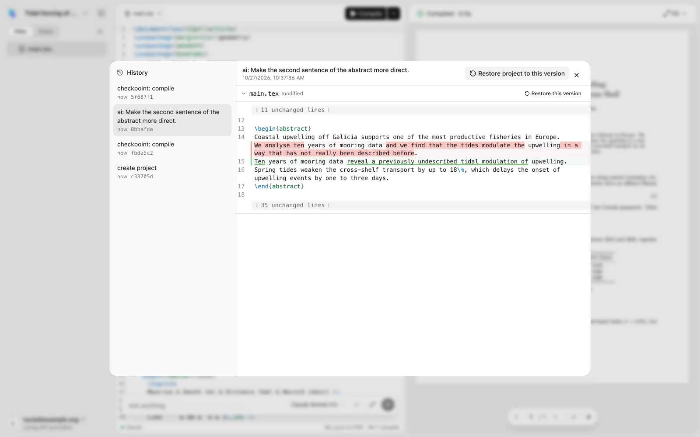
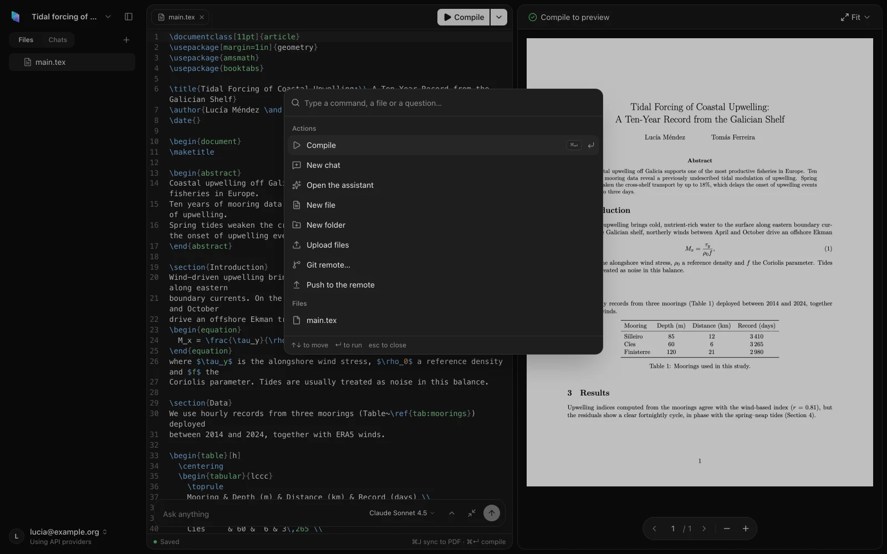
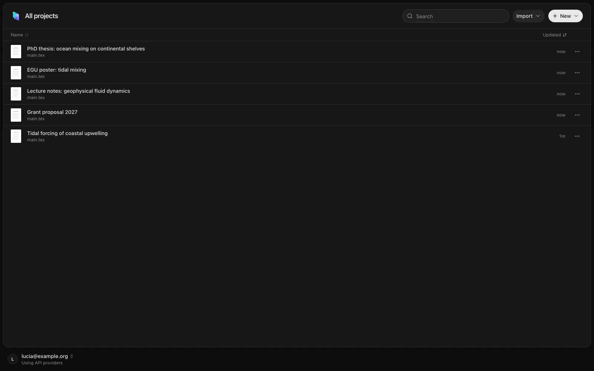
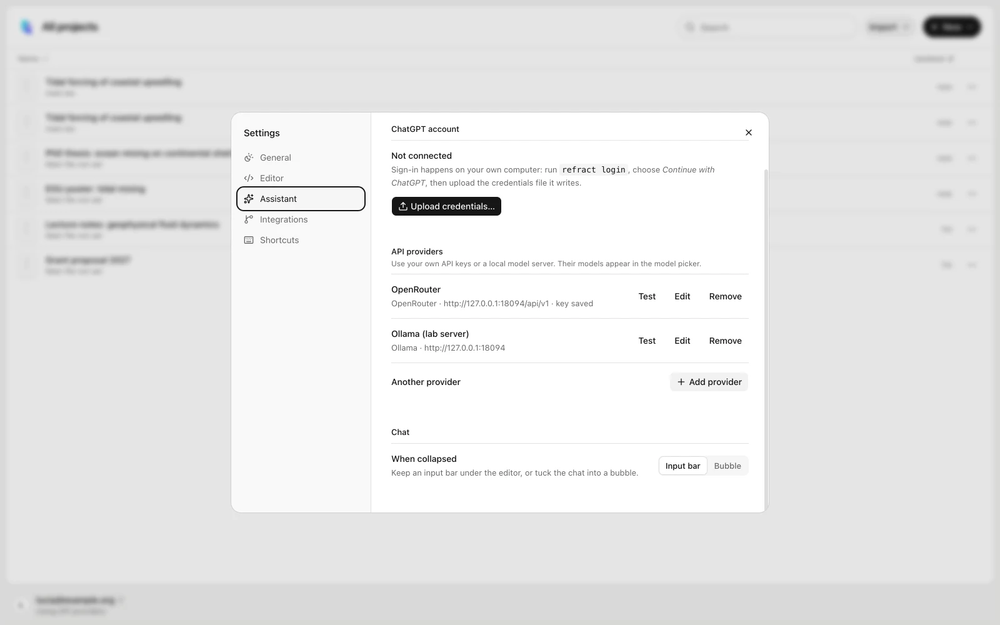
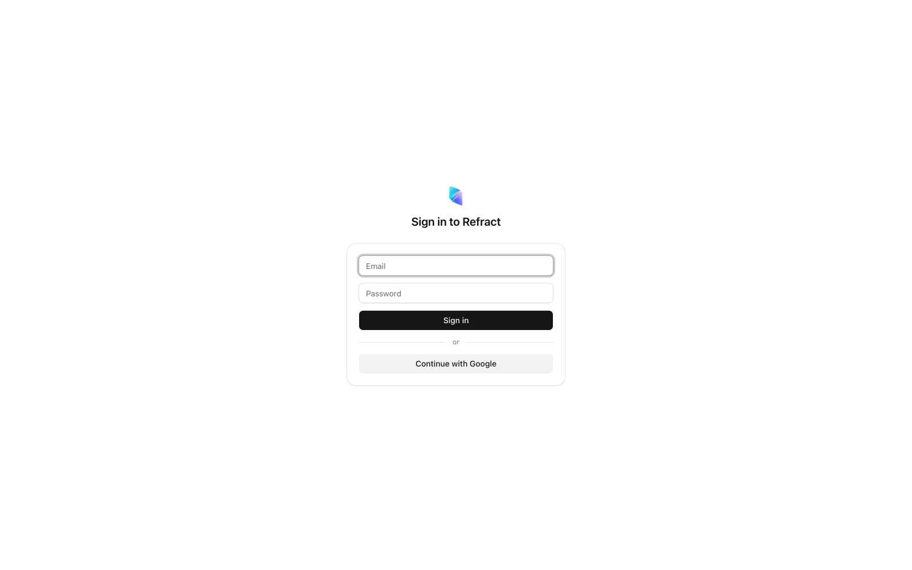

<p align="center"></p>

<h1 align="center">Refract</h1>

<p align="center">
A self-hosted LaTeX workspace with an AI assistant that proposes changes you review as diffs.<br>
Edit, compile and read the PDF side by side, cite real papers, and keep every version in git, on your own server.
</p>

<p align="center">
<a href="https://github.com/ponytojas/Refract/releases/latest"></a>
<a href="https://github.com/ponytojas/Refract/pkgs/container/refract"></a>
<a href="https://github.com/ponytojas/Refract/actions/workflows/ci.yml"></a>
<a href="https://github.com/ponytojas/Refract/actions/workflows/security.yml"></a>
<a href="go.mod"></a>
<a href="LICENSE"></a>
</p>

<p align="center">
<a href="#quick-start">Quick start</a> ·
<a href="#features">Features</a> ·
<a href="#screenshots">Screenshots</a> ·
<a href="#deploy">Deploy</a> ·
<a href="#ai-models">AI models</a> ·
<a href="#configuration">Configuration</a> ·
<a href="#development">Development</a>
</p>

<picture>
  <source media="(prefers-color-scheme: dark)" srcset="assets/screenshots/hero-dark.webp">
  
</picture>

## Why Refract

Refract started as a replacement for OpenAI Prism: it opens Prism's exports as they are and keeps what made it useful (an editor next to the PDF, an assistant that understands the whole project) while running on infrastructure you control.

- **Your files stay yours.** Projects are plain folders and git repositories on your server. Export any project as a .zip, or push it to GitHub or any git remote.
- **The assistant never edits behind your back.** It works on a copy of the project, can compile and fix its own errors, and hands you a diff. Nothing changes until you accept it, file by file if you like.
- **Citations come from real metadata.** The assistant searches OpenAlex and arXiv, and every bibliography entry is built from the publisher's or arXiv's record, never written by a model.
- **Use the AI you already pay for.** Your ChatGPT plan, your own API keys (OpenAI, Anthropic, Gemini, OpenRouter and more), or local models through Ollama.

## Features

### Editor and PDF

- LaTeX editor (CodeMirror) with tabs, autosave and syntax highlighting.
- Compilation with [Tectonic](https://tectonic-typesetting.github.io): no TeX distribution to install, packages are fetched and cached on first use. Errors and warnings are listed with file and line, each with **Fix with AI**.
- PDF preview with SyncTeX in both directions: <kbd>⌘J</kbd> shows the cursor's position in the PDF, <kbd>⌘</kbd>-click in the PDF jumps to the source.
- A right-click menu in the PDF (go to source, zoom, download).
- Command palette (<kbd>⌘K</kbd>) and a shortcut overlay (hold <kbd>⌘</kbd> or press <kbd>?</kbd>).
- English and Spanish interface, light and dark themes. Installable as an app from the browser.

### Fonts

Named `fontspec` families, such as `\setmainfont{Open Sans}`, are prepared automatically when you compile. Refract first looks for `.ttf` and `.otf` files included in the project, then uses the TeX bundle for standard Latin Modern and TeX Gyre text families, and otherwise downloads static faces from Google Fonts. Regular, bold, italic and bold italic are selected when the family supplies them. `\IfFontExistsTF` recognizes resolved families, and explicit font file selections keep their original options.

Your `.tex` files are left unchanged. Generated assets live in the project's private `.refract/` directory; public Google Fonts downloads are cached under `REFRACT_DATA_DIR/font-cache` and reused across projects and restarts. Uploaded project fonts stay private to that project. Only the requested family name is sent to Google, never document text. Set `REFRACT_FONT_DOWNLOADS=0` to use project, TeX bundle and previously cached fonts without contacting Google Fonts. Tectonic's TeX bundle has its own first-use downloads as usual.

For a font that Google Fonts does not supply, include its licensed font files in the project. Literal family names in fontspec commands are detected automatically; names assembled through TeX macros and custom file/face options remain under the document's control. A genuinely unavailable font is reported during compilation instead of producing repeated import warnings. Fonts are never silently replaced with a different family.

### Assistant

- A chat per topic, docked beside the PDF or floating over the editor.
- The agent can list, read, search, edit and create files, compile the project, search papers and add citations. It works in a separate git worktree, so you can keep writing while it runs.
- Changes arrive as a review: a diff per file, accepted or rejected all at once or file by file. Accepting creates one commit; rejecting leaves no trace.
- Shows the model's reasoning while it thinks, when the model provides it, folded away once it answers.
- Each chat remembers the model and reasoning level it used.

### Quick actions

Select text and a toolbar offers **Improve**, **Shorten**, **Fix grammar**, **Table**, **Explain**, or a free instruction (<kbd>⌘K</kbd> with a selection). The result appears inline as a word diff: <kbd>Tab</kbd> accepts, <kbd>Esc</kbd> rejects.

### References

- **Find papers for a passage:** the assistant turns the passage into searches, looks in [OpenAlex](https://openalex.org) (published work) and [arXiv](https://arxiv.org) (preprints), and suggests the papers that support it, with a reason for each.
- **Cite:** Refract adds the BibTeX entry to your `.bib` file from doi.org or arXiv metadata, and places `\cite{…}` in the text as a change you review.
- Paste a DOI, an arXiv id or a URL to cite one specific paper.

### Projects, history and sync

- Create a blank project, or import a Prism export (.zip) or a folder. Imports are checked: up to 200 MB and 5,000 files, nothing outside the project, no symlinks.
- Every project is a git repository. Compiling, accepting AI changes and restoring old versions all create commits. The history view shows each version's diff and restores a file or the whole project, as a new commit.
- Push and pull to any https git remote with a token, or connect a GitHub account and pick or create repositories from Refract. Optional auto-push after each commit.
- Export any project as a .zip at any time.

### Accounts

- Several users, each with their own projects, chats, AI connections and GitHub account. Nothing is shared between users.
- Sign-in through Cloudflare Access, Refract's own sign-in page (passwords and, optionally, OpenID Connect such as Google, Microsoft Entra, Keycloak or Authentik), or no sign-in on a private network.

## Screenshots

<table>
  <tr>
    <td width="50%"></td>
    <td width="50%"></td>
  </tr>
  <tr>
    <td><b>Docked assistant.</b> The chat as a side panel, with the change it proposes open for review.</td>
    <td><b>Quick actions.</b> Improve a selected sentence and accept the word diff with <kbd>Tab</kbd>.</td>
  </tr>
  <tr>
    <td></td>
    <td></td>
  </tr>
  <tr>
    <td><b>Model picker.</b> Reasoning levels for the current model, and every model grouped by provider.</td>
    <td><b>History.</b> Every version with its diff; restore a file or the whole project.</td>
  </tr>
  <tr>
    <td></td>
    <td></td>
  </tr>
  <tr>
    <td><b>Command palette.</b> Every action and file, a keystroke away.</td>
    <td><b>Projects.</b> All your projects; import Prism exports or folders.</td>
  </tr>
  <tr>
    <td></td>
    <td></td>
  </tr>
  <tr>
    <td><b>AI connections.</b> Your ChatGPT plan, API keys and local model servers.</td>
    <td><b>Sign-in.</b> Passwords, with an optional OpenID Connect provider.</td>
  </tr>
</table>

The paper in these screenshots is a made-up example, and the AI responses come from a scripted test model.

## Quick start

Try Refract on your own computer in a few minutes. You need [Docker](https://docs.docker.com/get-docker/).

> **Using an AI coding agent?** Ask it to follow [AGENTS.md](AGENTS.md): a step-by-step guide for agents to get Refract running for you, whether you want to try it, work on the code or put it on a server.

```sh
docker run -d --name refract -p 127.0.0.1:8080:8080 -v refract-data:/data \
  -e REFRACT_SECRET_KEY="$(openssl rand -base64 32)" \
  -e REFRACT_AUTH=none \
  ghcr.io/ponytojas/refract
```

Open <http://localhost:8080>, create a project or drop a Prism .zip on the page, and press <kbd>⌘↵</kbd> to compile. The first compile downloads the LaTeX packages it needs, so it takes longer than the next ones.

To use the assistant, connect an AI in **Settings → Assistant** (see [AI models](#ai-models)).

`REFRACT_AUTH=none` means no sign-in at all: keep it to your own machine (the `127.0.0.1:` above makes sure of that). To put Refract on a server, read [Deploy](#deploy).

## Deploy

Refract is a single container: the Go server with the web app built in, Tectonic, SyncTeX and git. It listens on port 8080 and keeps everything under `/data`.

```sh
docker run -d --name refract --restart unless-stopped \
  -p 127.0.0.1:8080:8080 -v refract-data:/data \
  -e REFRACT_SECRET_KEY="<the output of: openssl rand -base64 32>" \
  -e REFRACT_AUTH=password \
  ghcr.io/ponytojas/refract:0.1
```

Each release publishes the image for amd64 and arm64 as `latest`, as `0.1` (the newest 0.1.x, which only gets fixes) and as the exact version, such as `0.1.0`. To build it yourself instead, run `docker build -t refract .` in this repository, or `make docker`, which also tests it for both architectures.

**Keep `REFRACT_SECRET_KEY` safe and stable.** It encrypts the stored ChatGPT credentials, API keys and git tokens. With a different key, those can't be read back and users have to connect again.

### Choose how people sign in

Refract refuses to start until `REFRACT_AUTH` says how people get in.

| `REFRACT_AUTH` | Who gets in | Use it when |
|---|---|---|
| `cloudflare` (default) | Whoever your [Cloudflare Access](https://developers.cloudflare.com/cloudflare-one/applications/) policy allows. Refract verifies Access's token itself, so reaching the server directly doesn't bypass it. | Refract is behind a Cloudflare Tunnel or proxy. |
| `password` | Accounts you create, with a password and optionally an OpenID Connect provider. | Any other public deployment. Serve it over https. |
| `none` | Anyone who can reach the port, as a single local user. | Only on your own machine or a private network. |

**Cloudflare Access:** set `REFRACT_CF_TEAM_DOMAIN` (e.g. `yourteam.cloudflareaccess.com`) and `REFRACT_CF_AUD` (the application's AUD tag). Each email Access lets in gets its own account on first visit.

**Passwords:** create accounts on the server. The command prints a generated password, which the user can change in **Settings → General**. Running it again for the same email resets the password and signs that user out everywhere.

```sh
docker exec refract refract users add ana@example.com
docker exec refract refract users list
```

To end all of someone's sessions (a lost laptop, say), run `refract users signout <email>`. After too many failed sign-ins an account waits 15 minutes; `refract users unlock <email>` lets it in at once. To delete an account with its projects, chats and connections, run `refract users remove <email>`: it lists what would go, and deletes only when run again with `--yes`. With Cloudflare Access, also remove the person from your Access policy, or they get a new, empty account on their next visit.

### Sign in with OpenID Connect

With `REFRACT_AUTH=password`, an OpenID Connect provider (Google, Microsoft Entra, Keycloak, Authentik, Authelia…) can add a **Continue with …** button next to the password form.

1. Register Refract with your provider as a web application. The redirect URI is `https://<your Refract address>/api/auth/oidc/callback`.
2. Set `REFRACT_PUBLIC_URL` (e.g. `https://refract.example.com`), `REFRACT_OIDC_ISSUER`, `REFRACT_OIDC_CLIENT_ID`, `REFRACT_OIDC_CLIENT_SECRET`, and optionally `REFRACT_OIDC_NAME` for the button label.
3. Decide who may sign in. By default, only emails that already have an account (from `refract users add`). To let people create their account by signing in, list their emails or domains in `REFRACT_OIDC_ALLOWED`, e.g. `@lab.example.org,guest@example.com`.

The provider must report the email as verified. The sign-in uses the authorization code flow with PKCE, and the ID token is checked against the provider's keys.

### Behind a reverse proxy

Put Refract behind a proxy that terminates https. Two things matter:

- **Send `X-Forwarded-Proto` and `X-Forwarded-For`.** Refract marks its session cookie `Secure` when the request came over https, and limits sign-in attempts per client address. It reads that address from `X-Forwarded-For` only when the request comes from the same machine or a private network, where your proxy is; otherwise anyone could forge it.
- **Don't buffer responses.** The assistant streams its answer (server-sent events); a buffering proxy holds it back until the end.

[Caddy](https://caddyserver.com) does all of this by default:

```caddy
refract.example.com {
	reverse_proxy 127.0.0.1:8080
}
```

With nginx:

```nginx
location / {
    proxy_pass http://127.0.0.1:8080;
    proxy_set_header Host $host;
    proxy_set_header X-Forwarded-Proto $scheme;
    proxy_set_header X-Forwarded-For $proxy_add_x_forwarded_for;
    proxy_buffering off;          # stream the assistant's answers
    proxy_read_timeout 15m;       # long assistant turns
    client_max_body_size 200m;    # project imports
}
```

### Data, backups and upgrades

Everything lives in the `/data` volume:

| Path | Contents |
|---|---|
| `refract.db` | Users, sessions, projects, chats and settings (SQLite). Credentials and keys in it are encrypted with `REFRACT_SECRET_KEY`. |
| `projects/` | One git repository per project. |
| `tectonic-cache/` | LaTeX packages Tectonic has downloaded. Safe to delete: they come back on the next compile. |
| `tmp/` | Uploads in progress. |

To back up, stop the container, copy the volume, and keep `REFRACT_SECRET_KEY` with the copy.

To upgrade, pull the new image (`docker pull ghcr.io/ponytojas/refract:0.1`, or a newer version's tag) and start a new container on the same volume. Database changes are applied automatically at startup.

### Moving from `REFRACT_AUTH=none` to a sign-in mode

Data created without sign-in belongs to an account called `local`. Give it your email before switching, so your projects and connections stay yours:

```sh
docker exec refract refract users rename local you@example.com
docker exec refract refract users add you@example.com   # prints your password
```

Then restart with the new `REFRACT_AUTH`. With Cloudflare Access, the rename alone is enough.

## AI models

Each user connects their own AI in **Settings → Assistant**. Every connected model appears in the model picker under the chat, grouped by provider, with a search field when the list is long. Models that accept a reasoning setting show the levels they support.

### ChatGPT plan

Refract can use a ChatGPT subscription through "Sign in with ChatGPT", so requests count against your plan instead of an API bill. The sign-in runs on your own computer, because ChatGPT only accepts it from a local address:

1. Download `refract` for your system from [Releases](https://github.com/ponytojas/Refract/releases), or run `make login` from a clone.
2. Run `refract login` and choose **Continue with ChatGPT** in the browser that opens.
3. Upload the credential file it writes in **Settings → Assistant**.

On macOS, a binary downloaded with a browser is quarantined because it isn't signed. Run `xattr -d com.apple.quarantine refract` once.

To restrict a server to one ChatGPT account, set `REFRACT_ALLOWED_SUBJECT` to the subject `refract login` prints.

### API keys and local models

Add providers in **Settings → Assistant → API providers**. **Test** checks the key by listing the provider's models.

| Provider | Key | Reasoning levels |
|---|---|---|
| OpenAI | Required | o-series, GPT-5 and codex models: low, medium, high, with reasoning summaries |
| Anthropic | Required | Claude 3.7 and later: extended thinking off, low, medium or high |
| Google Gemini | Required | Gemini 2.5 (low, medium, high) and Gemini 3 (low, high), with thoughts |
| OpenRouter | Required | Models OpenRouter marks as supporting reasoning |
| Mistral, DeepSeek, xAI, Groq | Required | The model's default |
| Ollama | None | The model's default |
| OpenAI-compatible (LM Studio, vLLM, LiteLLM…) | Optional | The model's default |

- Keys are encrypted, belong to the user who added them, and are never sent back to the browser.
- For endpoints that can't list their models, type the model ids in the provider's settings.
- Base URLs must be reachable from the Refract server: from inside Docker, a local Ollama is usually `http://host.docker.internal:11434`. Private and loopback addresses are allowed; link-local addresses (cloud metadata services) are refused.
- Refract sets no spending limits. Usage is between you and the provider.

`REFRACT_MODEL_AGENT` and `REFRACT_MODEL_QUICK` set default models for the assistant and for quick actions and citations, used until a user picks one.

## Configuration

All settings are environment variables.

| Variable | Purpose |
|---|---|
| `REFRACT_SECRET_KEY` | **Required.** 32 bytes, base64 (`openssl rand -base64 32`). Encrypts stored credentials and keys. |
| `REFRACT_AUTH` | `cloudflare` (default), `password` or `none`. See [Choose how people sign in](#choose-how-people-sign-in). |
| `REFRACT_DATA_DIR` | Where projects, the database and caches live. Default `/data`. |
| `REFRACT_ADDR` | Listen address. Default `:8080`. |
| `REFRACT_CF_TEAM_DOMAIN`, `REFRACT_CF_AUD` | Cloudflare Access team domain and application AUD tag. |
| `REFRACT_PUBLIC_URL` | The address users open Refract at, e.g. `https://refract.example.com`. Needed for OpenID Connect. |
| `REFRACT_OIDC_ISSUER`, `REFRACT_OIDC_CLIENT_ID`, `REFRACT_OIDC_CLIENT_SECRET` | Your OpenID Connect provider's issuer URL and Refract's client credentials there. |
| `REFRACT_OIDC_NAME` | Label of the sign-in button: *Continue with …*. Default `SSO`. |
| `REFRACT_OIDC_ALLOWED` | Comma-separated emails and `@domains` that may create an account by signing in with OpenID Connect. Empty: existing accounts only. |
| `REFRACT_ALLOWED_SUBJECT` | The only ChatGPT account accepted (printed by `refract login`). |
| `REFRACT_MODEL_AGENT` | Default model for the assistant. |
| `REFRACT_MODEL_QUICK` | Default model for quick actions and citations. |
| `REFRACT_COMPILE_TIMEOUT` | Seconds per compile. Default 90. |
| `REFRACT_FONT_DOWNLOADS` | `0` disables Google Fonts requests; project, TeX bundle and cached fonts still work. Default: downloads enabled. |
| `REFRACT_GITHUB_CLIENT_ID` | Client ID of your GitHub OAuth App, to connect GitHub accounts (see below). |
| `REFRACT_OPENALEX_API_KEY` | A free [OpenAlex key](https://openalex.org/settings/api). Without one, paper searches share a small daily budget per IP address. |
| `REFRACT_TECTONIC_BUNDLE` | Pinned Tectonic bundle URL. Set in the image. |

### Connect GitHub

Without this, any project can still push to and pull from an https git remote with a personal access token. To let users pick or create GitHub repositories from Refract:

1. Create a [GitHub OAuth App](https://github.com/settings/developers) and check **Enable Device Flow**. The callback URL is not used, and no client secret is needed.
2. Set `REFRACT_GITHUB_CLIENT_ID` to its client ID.
3. Each user connects their account in **Settings → Integrations**.

## Command line

```text
refract                         run the server (configured with REFRACT_* variables)
refract login                   sign in with ChatGPT on this computer and write a credential
                                file to upload in Settings → Assistant (refract login -h)
refract users add <email>       create an account or reset its password (REFRACT_AUTH=password)
refract users rename <a> <b>    change an account's email, keeping its data
refract users signout <email>   end all of an account's sessions
refract users unlock <email>    clear an account's failed sign-ins (--all: every account and address)
refract users remove <email>    delete an account and everything it owns (asks for --yes)
refract users list              list accounts
refract version                 print the version
```

`refract users` works on the server's database: run it with the same `REFRACT_DATA_DIR` and `REFRACT_SECRET_KEY` as the server. Inside the container, `docker exec refract refract users …` already has them.

## Keyboard shortcuts

On Windows and Linux, read <kbd>Ctrl</kbd> for <kbd>⌘</kbd>. Hold <kbd>⌘</kbd> anywhere in Refract to see them all.

| Keys | Action |
|---|---|
| <kbd>⌘K</kbd> | Command palette; with text selected, quick actions |
| <kbd>⌘↵</kbd> | Compile |
| <kbd>⌘J</kbd> | Show the cursor's position in the PDF |
| <kbd>⌘</kbd>-click in the PDF | Jump to the source |
| <kbd>⌘S</kbd> | Save now (it also saves on its own) |
| <kbd>Tab</kbd> / <kbd>Esc</kbd> | Accept / reject a quick action's suggestion |
| <kbd>↵</kbd> / <kbd>⇧↵</kbd> | Send / new line in the chat |

## Security

- **Sign-in:** Cloudflare Access tokens are verified on every request. Passwords are hashed with PBKDF2-SHA256 (600,000 iterations). Repeated failures for an account, or from one address, are refused for 15 minutes; the counts survive restarts. Sessions are random tokens stored only as hashes, in `HttpOnly`, `SameSite=Lax` cookies that last 30 days.
- **Requests:** every API call must carry a custom header that browsers can't add cross-site, which blocks cross-site request forgery.
- **Browser:** a strict Content-Security-Policy lets the app run only its own scripts and connect only to its own server. Refract can't be embedded in other sites, and over https it sends `Strict-Transport-Security`.
- **Secrets at rest:** ChatGPT credentials, API keys and git tokens are encrypted with AES-GCM under `REFRACT_SECRET_KEY`, each bound to its owner.
- **Isolation between users:** projects, chats and connections are checked against their owner on every access.
- **Compilation:** Tectonic runs with shell escape disabled (`--untrusted`) and a time limit. Imports are size-limited and can't write outside the project.
- **Outbound requests:** user-supplied AI provider URLs can't reach link-local addresses such as cloud metadata services. Compiling a document that names a font found neither in the project nor in the TeX bundle downloads it from Google Fonts, sending only the family name; `REFRACT_FONT_DOWNLOADS=0` turns that off.

Found a vulnerability? Please report it privately through the repository's **Security** tab (*Report a vulnerability*) rather than in a public issue.

## Development

You need Go, Node.js, git, ripgrep, Tectonic and `synctex` (and Google Chrome for the browser test). The image bundles all of them. [AGENTS.md](AGENTS.md) lists how to check and install each one, and the conventions to follow when changing the code.

```sh
make dev                                  # API on :8080 and Vite on :5173; open http://localhost:5173
make dev AUTH=password                    # the same, with the sign-in page
make users ARGS="add you@example.com"     # accounts in the development data
make login                                # refract login, for ChatGPT
make test                                 # go vet, Go tests and web unit tests
make e2e                                  # build, then a Playwright smoke test
make docker                               # images for amd64 and arm64, each smoke-tested
```

Development data lives in `./data`, with its own key in `data/dev.key`. To contribute, see [CONTRIBUTING.md](CONTRIBUTING.md).

### How it's built

- **Server:** Go's standard HTTP server, SQLite ([modernc.org/sqlite](https://modernc.org/sqlite), no cgo), git through the git command line, [go-oidc](https://github.com/coreos/go-oidc) for Cloudflare Access and OpenID Connect, and [GoAI](https://github.com/zendev-sh/goai) for API-key providers.
- **Web app:** React, TypeScript, Vite, Tailwind CSS, [Base UI](https://base-ui.com), CodeMirror 6 and PDF.js, embedded in the Go binary.
- **Compilation:** [Tectonic](https://tectonic-typesetting.github.io) with a pinned bundle, and SyncTeX for source ↔ PDF positions.

| Directory | What it holds |
|---|---|
| `cmd/refract` | The binary: HTTP API, wiring, and the `login` and `users` commands |
| `internal/projects` | Projects as git repositories: files, imports, history, worktrees, remotes |
| `internal/compile` | Tectonic runs, log parsing and SyncTeX |
| `internal/agent`, `internal/assistant` | The assistant's tool loop; chats, turns and reviews |
| `internal/ai`, `internal/siwc`, `internal/providers` | The AI interface, the ChatGPT plan, and API-key providers |
| `internal/quick`, `internal/cite`, `internal/openalex`, `internal/arxiv`, `internal/refs` | Quick actions and citations |
| `internal/auth`, `internal/users` | Sign-in modes, accounts and sessions |
| `internal/store` | SQLite, migrations and encrypted settings |
| `web/` | The web app |

### CI and releases

Every push to `main` and every pull request runs the Go tests (with the race detector), the web tests and the browser tests (`.github/workflows/ci.yml`).

Pushing a tag such as `v0.1.0` builds `refract` for macOS, Linux and Windows (amd64 and arm64) and publishes the archives with checksums on GitHub Releases. It also tests and publishes the Docker image for amd64 and arm64 to GitHub Container Registry (`.github/workflows/release.yml`).

## License

Refract is released under the [MIT License](LICENSE).

## Acknowledgements

Refract stands on [Tectonic](https://tectonic-typesetting.github.io), [SyncTeX](https://github.com/jlaurens/synctex), [CodeMirror](https://codemirror.net), [PDF.js](https://mozilla.github.io/pdf.js/), [OpenAlex](https://openalex.org), [arXiv](https://arxiv.org) and [GoAI](https://github.com/zendev-sh/goai). Thank you to their authors and maintainers.
